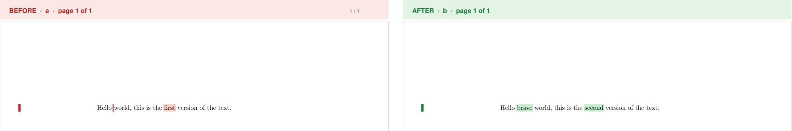
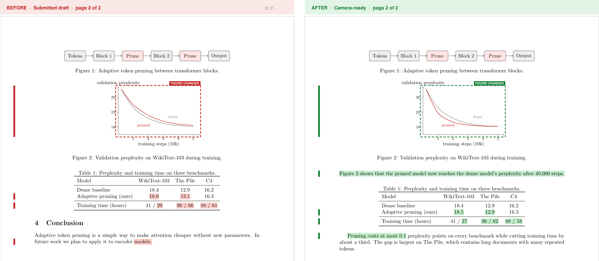
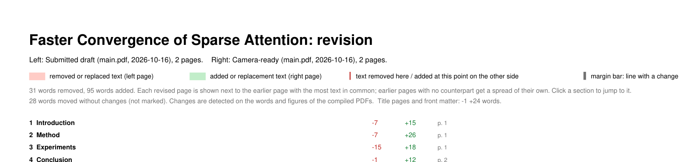

<div align="center">

# redlatex

**See exactly what changed between two versions of your LaTeX paper.**<br>
A side-by-side, word-level visual diff of compiled PDFs, with changes highlighted in red and green.

[](https://github.com/stormaref/redlatex/actions/workflows/ci.yml)
[](https://pypi.org/project/redlatex/)
[](LICENSE)


[**Try it online**](https://redlatex.onrender.com) · [GitHub Action](#github-action) · [Command line](#command-line) · [Self-host](#self-hosting) · [How it works](#how-it-works)

</div>





<p align="center"></p>

## Why

`latexdiff` compares LaTeX *source*, which breaks on custom macros, `\input` trees and `\newcommand`s, and tells
you nothing about what a reader sees. Reviewers and co-authors want to see the change on the page.

redlatex compiles both versions and compares the **words in the rendered PDFs**. Numbers, resolved references,
captions and bibliography entries are all compared as the reader sees them.

- **Side by side.** Every revised page sits next to its matching earlier page.
- **Word-level.** Removed words are red on the left, added words green on the right, with a margin bar beside
  each changed line and a caret where text is missing on the other side.
- **Cover summary.** The first page counts removed and added words per section, each linking to its spread.
  The output also carries a bookmark per section.
- **Changed figures.** Plots, diagrams and images whose pixels changed get a dashed frame on both sides.
- **Robust to layout.** Text and floats that only moved, words hyphenated across lines and page numbers do not
  show up as edits.
- **Fast.** A 200-page document is compared in a few seconds.
- **No LaTeX source parsing.** If it compiles, it can be diffed. You can also diff two existing PDFs.

## Use it online

Open **<https://redlatex.onrender.com>**, give it the earlier and the revised version of your document, and
download the diff PDF. Each version can be a `.zip` of the whole project (with figures, `.bib`, styles), a
single `.tex` file, or a branch, tag or commit of a public GitHub repository (Overleaf projects synced to GitHub
work too; otherwise use Overleaf's *Download → Source* zip). Progress is shown step by step. Your files are deleted as soon as the diff is made. The hosted instance is small and may take a few seconds to
wake up; for large projects or private work, run it yourself.

## GitHub Action

Get a diff PDF on every pull request that touches your paper. Add this workflow to your LaTeX repository:

```yaml
# .github/workflows/redlatex.yml
name: Paper diff
on: pull_request
permissions:
  contents: read
  pull-requests: write      # to comment with the link
jobs:
  diff:
    runs-on: ubuntu-latest
    steps:
      - uses: actions/checkout@v4
        with:
          fetch-depth: 0
      - uses: stormaref/redlatex@v0.2.0
        with:
          tex: main.tex       # path of the main file
```

The action installs TeX Live, compiles the pull request's base and head, uploads `redlatex-diff.pdf` as an
artifact and comments on the pull request with a summary and a download link (the comment is updated on later
pushes instead of piling up).

| Input | Default | Meaning |
| --- | --- | --- |
| `tex` | `main.tex` | main `.tex` file |
| `old` / `new` | PR base / `HEAD` | revisions to compare (`HEAD~1` outside pull requests) |
| `working-directory` | `.` | repository root |
| `output` | `redlatex-diff.pdf` | where to write the PDF |
| `title` | `Document changes` | cover page title |
| `install-tex` | `true` | set to `false` if the job already has `latexmk` |
| `artifact-name` | `redlatex-diff` | artifact name; empty to skip the upload |
| `comment` | `true` | comment on the pull request |

Outputs: `pdf` (path), `summary` (e.g. `2 spreads, -31 +95 words, 0 changed figures`) and `artifact-url`.

## Command line

Requirements: Python 3.10+, [uv](https://docs.astral.sh/uv/), and, to compile from git revisions, `git` and a
TeX distribution with `latexmk`.

```bash
uvx redlatex --help          # run without installing
pip install redlatex         # or install it
```

Run it from the root of the git repository that holds your LaTeX project (or pass `--repo`):

```bash
# compare a tagged revision with HEAD
uv run redlatex --old v1 --new HEAD

# compare HEAD with the working tree (the default), main file in a subfolder
uv run redlatex --tex paper/main.tex --out changes.pdf

# compare two PDFs directly (no git, no latexmk)
uv run redlatex --old-pdf before.pdf --new-pdf after.pdf

# run against another repository
uv run --project /path/to/redlatex redlatex --repo /path/to/paper --old v1
```

| Option | Default | Meaning |
| --- | --- | --- |
| `--repo` | `.` | git repository root |
| `--tex` | `main.tex` | main `.tex` file, relative to the repo |
| `--old` | `HEAD` | earlier git revision (or `WORKTREE`) |
| `--new` | `WORKTREE` | revised git revision (or `WORKTREE` for the working tree) |
| `--old-pdf`, `--new-pdf` | | use these PDFs instead of compiling |
| `--old-label`, `--new-label` | revision or PDF name | labels in the page headers |
| `--title` | `Document changes` | cover page title |
| `--out` | `./revision-diff.pdf` | output PDF |

Revisions are compiled with `latexmk -pdf` in temporary directories. A revision is exported with `git archive`
and the working tree is compiled in place with build files sent to a temporary directory, so your repository
is never modified.

## Self-hosting

The web app is a small [FastAPI](https://fastapi.tiangolo.com/) service. The Docker image bundles TeX Live.

```bash
docker build -t redlatex .
docker run -p 10000:10000 redlatex      # then open http://localhost:10000
```

Without Docker: `uv sync --extra web && uv run uvicorn redlatex.web:app` (needs `latexmk` on `PATH`).
Set `REDLATEX_PUBLIC_URL` to your site's address (e.g. `https://diff.example.org`) so link previews point at
your own preview image.

### Limits and security

The web app compiles LaTeX written by strangers, so it is locked down in layers:

| Area | Protection |
| --- | --- |
| Compile time | 45 s per version and 90 s for both (`REDLATEX_COMPILE_TIMEOUT`, `REDLATEX_COMPILE_BUDGET`); on timeout the whole process tree is killed. Building the diff gets 90 s (`REDLATEX_RENDER_TIMEOUT`). |
| LaTeX sandbox | shell escape off, TeX file access restricted to the project (`openin_any=p`, `openout_any=p`), a minimal environment with no inherited secrets, and CPU, memory and output-file-size limits on the compiler process |
| GitHub | only `codeload.github.com` is ever contacted; owner, repository and ref names are validated, so the server cannot be pointed at other hosts; downloads are size-limited like uploads |
| Uploads | `.zip` up to 50 MB (200 MB and 5000 files unpacked) or a `.tex` up to 5 MB; path-traversal and absolute-path checks; oversized requests refused from the `Content-Length` header before they are read |
| Size | documents are limited to 300 pages (`REDLATEX_MAX_PAGES`) |
| Abuse | one running diff per client IP, 20 diffs per hour per IP (`REDLATEX_RATE_PER_HOUR`), at most 2 diffs processed at once (`REDLATEX_MAX_JOBS`; others wait up to 20 s, then get a 503) |
| Browser | strict Content-Security-Policy (hash-based, no inline allowances), `nosniff`, no framing, HSTS, no referrer, no third-party requests |
| Server | runs as a non-root user, API docs disabled, no server banner, error messages never contain server paths, temporary files removed after every request |

Compiling is CPU- and memory-heavy and the service runs a single worker, so size your instance for the
documents and traffic you expect. Report vulnerabilities as described in [SECURITY.md](SECURITY.md).

### HTTP API

- `POST /diff` (multipart `old`, `new`, optional `tex`, `title`) returns the PDF directly:
  `curl -F old=@v1.zip -F new=@v2.zip https://redlatex.onrender.com/diff -o diff.pdf`
- `POST /api/jobs` starts a diff in the background (`mode=upload` with `old`/`new`, or `mode=github` with `repo`,
  `old_ref`, `new_ref`) and returns `{"id": ...}`; `GET /api/jobs/{id}` reports the stage (`queued`,
  `fetch-old`, `compile-old`, `fetch-new`, `compile-new`, `diff`, `done` or `error`); `GET /api/jobs/{id}/pdf`
  returns the PDF once, then deletes it.

### Deploy to Render

1. Create a Render **Web Service** from your fork; the Docker runtime picks up the `Dockerfile` (`render.yaml`
   is a ready blueprint). Use at least the Starter instance: compiling LaTeX needs more than 512 MB.
2. Copy the service's **Deploy Hook** URL and save it as the repository secret `RENDER_DEPLOY_HOOK_URL`.
3. Turn off Render's own auto-deploy. `ci.yml` tests and builds on every push, and `deploy.yml` calls the hook
   once CI has passed on `main`.

## How it works

1. Both versions are compiled to PDF (or taken as given).
2. Words are extracted with [PyMuPDF](https://pymupdf.readthedocs.io/). Body text and small print (captions,
   tables, footnotes) are compared as separate streams, words hyphenated across a line break are joined, and page
   numbers are ignored.
3. The word diff is anchored on word triples that occur exactly once in both versions (as in patience diff), so
   it runs in near-linear time; a classic diff only runs on the short stretches between anchors.
4. Removed and added runs that share six or more words in a row are treated as moved text and not marked; this is
   what keeps a float that LaTeX placed elsewhere from looking like a rewrite.
5. Figures (embedded images and dense vector drawings) are rendered to small thumbnails; a figure without a
   pixel-identical counterpart in the other version is framed as changed.
6. Each revised page is paired with the earlier page that shares the most matched words (at least 25, or a third
   of a short page); earlier pages without a counterpart get a spread of their own.
7. Section counts use the PDF bookmarks, so build your document with `hyperref`. Removed words count towards the
   section they were deleted from.

## Limitations

- Figure changes are detected per figure, not located inside it, and very small edits (below 0.2% of a
  figure's pixels at thumbnail size) can be missed. Tables drawn only with rules are compared as text.
- Only text is compared; purely visual changes such as colours or spacing are not marked.
- Appendix sections are lettered only when the LaTeX source of the revised version is readable (a git
  revision, the working tree, or an uploaded zip) and contains `\appendix`.
- Compilation is a plain `latexmk -pdf` run. Documents that need another engine or special options should be
  compiled by hand and passed with `--old-pdf` / `--new-pdf`.

## Contributing

Bug reports, test documents that break the matching, and pull requests are welcome. See
[CONTRIBUTING.md](CONTRIBUTING.md).

## License

[MIT](LICENSE)
